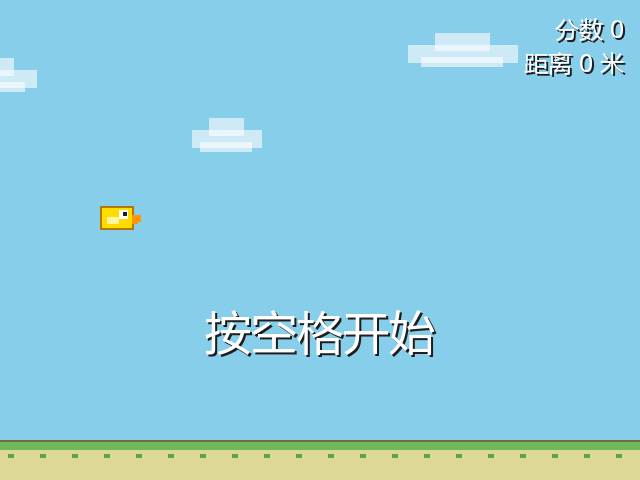
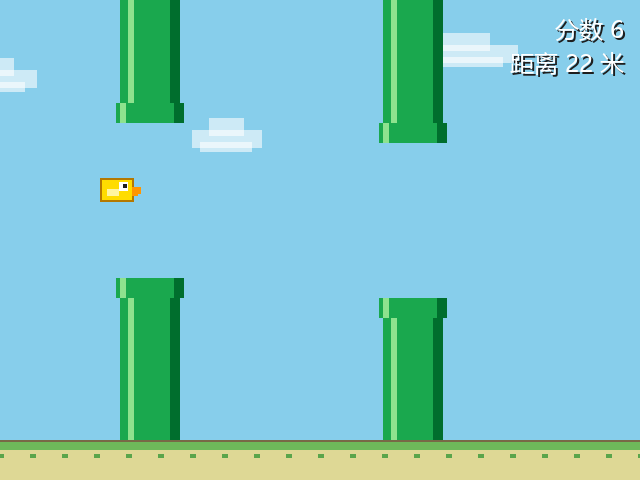
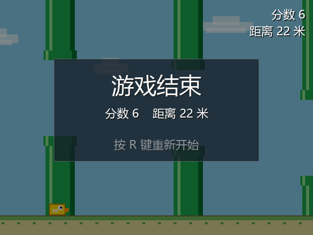

# Flappy Bird 风格跑酷（C++17 + SDL2 + SDL2_ttf）

一个可以直接编译运行的跨平台小游戏：小鸟受重力下落，按空格向上飞，穿过从右向左移动的管道得分，
撞到管道 / 上下边界游戏结束，按 R 重开。

当前是**纯色方块版**——不需要任何图片资源，只要 SDL2 + SDL2_ttf + 一个字体就能跑；
美术、音效的升级方法见 [第 8 节](#8-升级贴图版sdl2_image) 和 [第 9 节](#9-升级音效版sdl2_mixer)。







---

## 目录结构

```text
.
├── src/
│   ├── main.cpp            # 程序入口（Windows 的 SDL_main 处理也在这里）
│   ├── game.h / game.cpp   # 主循环、状态机、HUD
│   ├── bird.h / bird.cpp   # 小鸟
│   ├── pipe.h / pipe.cpp   # 管道与对象池
│   ├── text.h / text.cpp   # 文字纹理缓存
│   ├── config.h            # 可调常量与颜色
│   ├── state.h             # State / Align
│   ├── raii.h              # SDL / TTF RAII 封装
│   └── util.h              # 随机数工具
├── CMakeLists.txt          # 跨平台构建（Windows / Linux / macOS）
├── README.md               # 本文档
├── DESIGN.md               # 游戏设计文档（玩法、参数、架构）
├── assets/
│   ├── DejaVuSans.ttf      # 兜底字体（找不到系统中文字体时使用，界面自动切换成英文）
│   └── FONT-LICENSE.txt    # DejaVu 字体许可证
├── screenshot-ready.png
├── screenshot.png
└── screenshot-gameover.png
```

## 特性

- 640×480 窗口、天空蓝背景、滚动的草地，纯 `SDL_RenderFillRect` 绘制，**零图片资源**
- 固定 60 FPS 上限 + 固定物理步长（1/60 s）累加器：60Hz / 144Hz 屏手感一致
- 管道对象池：固定 3 对，移出屏幕后重置到右侧并重新随机缺口，**运行期不 new/delete**
- 碰撞使用 `SDL_HasIntersection` 做 AABB 矩形相交，判定盒略微内缩，手感更宽容
- 右上角 HUD：`分数` + `距离（米）`；中文 / 英文界面按字体能力自动切换
- 状态机：`Ready` / `Playing` / `GameOver`；空格开始，R 重开，ESC 退出
- 优雅降级：字体缺失时打印警告并继续运行；渲染器优先加速，失败逐级降级到软件渲染
- 全部 SDL 资源用 RAII 管理，退出前自动 `SDL_Quit` / `TTF_Quit`

---

## 1. 安装依赖

必需：**SDL2**、**SDL2_ttf**，以及支持 C++17 的编译器。
可选：**SDL2_image**（贴图版）、**SDL2_mixer**（音效版）。

### Ubuntu / Debian

```bash
sudo apt update
sudo apt install -y build-essential cmake libsdl2-dev libsdl2-ttf-dev

# 可选：贴图 / 音效
sudo apt install -y libsdl2-image-dev libsdl2-mixer-dev
```

### Fedora

```bash
sudo dnf install -y gcc-c++ cmake SDL2-devel SDL2_ttf-devel
# 可选：SDL2_image-devel SDL2_mixer-devel
```

### Arch / Manjaro

```bash
sudo pacman -S --needed base-devel cmake sdl2 sdl2_ttf
# 可选：sdl2_image sdl2_mixer
```

### macOS

```bash
brew install cmake sdl2 sdl2_ttf
# 想用下面的 g++ 一条命令编译，还需要 pkg-config：
brew install pkg-config
```

> Apple Silicon 的 Homebrew 前缀是 `/opt/homebrew`，`pkg-config` 会自动给出正确路径。

### Windows（MSYS2，最省事）

打开 **MSYS2 UCRT64** 终端：

```bash
pacman -S --needed mingw-w64-ucrt-x86_64-gcc \
                   mingw-w64-ucrt-x86_64-cmake \
                   mingw-w64-ucrt-x86_64-SDL2 \
                   mingw-w64-ucrt-x86_64-SDL2_ttf

# 直接编译（pkg-config 会给出正确的 -I / -L）
g++ -std=c++17 -O2 src/*.cpp -o flappy.exe $(pkg-config --cflags --libs sdl2 SDL2_ttf)
cp /ucrt64/bin/SDL2.dll /ucrt64/bin/SDL2_ttf.dll .
```

> MSYS2 的 `PATH` 已包含 `/ucrt64/bin`，在 MSYS2 终端里可以直接运行；拷给别人时记得带上
> `SDL2.dll`、`SDL2_ttf.dll`，以及 `libstdc++-6.dll`、`libgcc_s_seh-1.dll`、`libwinpthread-1.dll`
> （或者编译时加 `-static-libgcc -static-libstdc++`）。

### Windows（手动下载 MinGW 开发包）

1. 到 <https://github.com/libsdl-org/SDL/releases> 下载 `SDL2-devel-2.x.x-mingw.tar.gz`；
2. 到 <https://github.com/libsdl-org/SDL_ttf/releases> 下载 `SDL2_ttf-devel-2.x.x-mingw.tar.gz`；
3. 解压后把里面的 `x86_64-w64-mingw32` 目录放到 `C:\SDL2\`（SDL2_ttf 放到 `C:\SDL2_ttf\`），
   使下面的目录结构成立（32 位编译器才用 i686 目录）。

解压后的关键目录（下面命令按此路径书写）：

```text
C:\SDL2\x86_64-w64-mingw32\include\SDL2
C:\SDL2\x86_64-w64-mingw32\lib
C:\SDL2\x86_64-w64-mingw32\bin\SDL2.dll
C:\SDL2_ttf\x86_64-w64-mingw32\...
```

> MinGW 的位数必须与 DLL 一致。TDM-GCC 64 位 / MSYS2 UCRT64 / mingw-w64 x86_64 都可以。

---

## 2. 编译

### 2.1 方式 A：g++ 直接编译

#### Linux / macOS

```bash
g++ -std=c++17 -O2 -Wall -Wextra src/*.cpp -o flappy \
    $(pkg-config --cflags --libs sdl2 SDL2_ttf)
./flappy
```

#### Windows（MinGW-w64）

在 cmd 里（`^` 是换行符）：

```bat
g++ -std=c++17 -O2 src\main.cpp src\game.cpp src\bird.cpp src\pipe.cpp src\text.cpp -o flappy.exe ^
  -IC:/SDL2/x86_64-w64-mingw32/include/SDL2 ^
  -IC:/SDL2_ttf/x86_64-w64-mingw32/include/SDL2 ^
  -LC:/SDL2/x86_64-w64-mingw32/lib ^
  -LC:/SDL2_ttf/x86_64-w64-mingw32/lib ^
  -lmingw32 -lSDL2main -lSDL2 -lSDL2_ttf
```

**链接顺序不能乱**：`-lmingw32 -lSDL2main -lSDL2` 是 MinGW 的固定写法，
`SDL2main` 必须在 `SDL2` 前面。`-lSDL2_ttf` 放在最后即可。

编译成功后，把运行库和资源放到 `flappy.exe` 旁边：

```text
flappy.exe
SDL2.dll          ← 从 C:\SDL2\x86_64-w64-mingw32\bin 复制
SDL2_ttf.dll      ← 从 C:\SDL2_ttf\x86_64-w64-mingw32\bin 复制
assets\
  DejaVuSans.ttf
```

常用附加选项：

| 选项 | 作用 |
|---|---|
| `-mwindows` | 不弹出控制台窗口（此时必须链接 `-lSDL2main`） |
| `-static-libgcc -static-libstdc++` | 不依赖 `libstdc++-6.dll`、`libgcc_s_seh-1.dll`，方便拷给别人 |
| `-DFLAPPY_SDL_MAIN_HANDLED` | 不使用 `SDL2main`，由源码自己调用 `SDL_SetMainReady()` |
| `-O2 -s` | 优化 + 去掉符号，体积更小 |

`-mwindows` 完整示例：

```bat
g++ -std=c++17 -O2 -mwindows -static-libgcc -static-libstdc++ src\main.cpp src\game.cpp src\bird.cpp src\pipe.cpp src\text.cpp -o flappy.exe ^
  -IC:/SDL2/x86_64-w64-mingw32/include/SDL2 ^
  -IC:/SDL2_ttf/x86_64-w64-mingw32/include/SDL2 ^
  -LC:/SDL2/x86_64-w64-mingw32/lib ^
  -LC:/SDL2_ttf/x86_64-w64-mingw32/lib ^
  -lmingw32 -lSDL2main -lSDL2 -lSDL2_ttf
```

> **关于 `SDL_main`**：`SDL.h` 在 Windows 上会把 `main` 重定义成 `SDL_main`，
> 由 `SDL2main` 库提供真正的 `WinMain`。所以要么链接 `-lSDL2main`（推荐），
> 要么定义 `FLAPPY_SDL_MAIN_HANDLED`（本工程已内置支持），两者选一，不要都不做。

### 2.2 方式 B：CMake（推荐）

三平台先装好依赖，然后：

```bash
cmake -S . -B build -DCMAKE_BUILD_TYPE=Release
cmake --build build -j
```

运行：

```bash
./build/flappy          # Linux / macOS
build\flappy.exe        # Windows
```

CMake 会自动把 `assets/` 复制到可执行文件目录；在 Windows 上还会尝试复制 `SDL2.dll`、`SDL2_ttf.dll`。

#### Windows + MinGW

```bat
cmake -S . -B build -G "MinGW Makefiles" ^
  -DCMAKE_PREFIX_PATH="C:/SDL2/x86_64-w64-mingw32;C:/SDL2_ttf/x86_64-w64-mingw32"
cmake --build build
```

如果 CMake 找不到包，直接指定两个 config 目录：

```bat
cmake -S . -B build -G "MinGW Makefiles" ^
  -DSDL2_DIR="C:/SDL2/x86_64-w64-mingw32/lib/cmake/SDL2" ^
  -DSDL2_ttf_DIR="C:/SDL2_ttf/x86_64-w64-mingw32/lib/cmake/SDL2_ttf"
```

#### Windows + Visual Studio / vcpkg

```bat
vcpkg install sdl2 sdl2-ttf
cmake -S . -B build -DCMAKE_TOOLCHAIN_FILE=<vcpkg>/scripts/buildsystems/vcpkg.cmake
cmake --build build --config Release
```

CMake 选项：

| 选项 | 默认 | 说明 |
|---|---|---|
| `FLAPPY_USE_SDL2_IMAGE` | `OFF` | 链接 `SDL2_image`，并定义 `FLAPPY_HAVE_SDL2_IMAGE`（贴图版预留） |
| `FLAPPY_USE_SDL2_MIXER` | `OFF` | 链接 `SDL2_mixer`，并定义 `FLAPPY_HAVE_SDL2_MIXER`（音效版预留） |
| `FLAPPY_SDL_MAIN_HANDLED` | `OFF` | 走 `SDL_MAIN_HANDLED + SDL_SetMainReady()` 入口，不链接 `SDL2main` |
| `FLAPPY_WINDOWS_GUI` | `OFF` | Windows 下使用 GUI 子系统（不显示控制台），需链接 `SDL2main` |
| `FLAPPY_COPY_RUNTIME` | `ON` | 构建后复制 `assets/`（Windows 还复制 DLL）到 exe 目录 |

例如隐藏 Windows 控制台：

```bat
cmake -S . -B build -G "MinGW Makefiles" -DFLAPPY_WINDOWS_GUI=ON ...
```

#### 用 Visual Studio 手工建工程（不用 CMake）

1. 下载 `SDL2-devel-2.x.x-VC.zip` 与 `SDL2_ttf-devel-2.x.x-VC.zip` 并解压；
2. 项目属性 → C/C++ → 常规 → 附加包含目录：加 `include` 目录；
3. 链接器 → 常规 → 附加库目录：加 `lib\x64`；
4. 链接器 → 输入 → 附加依赖项：`SDL2main.lib; SDL2.lib; SDL2_ttf.lib`；
5. 链接器 → 系统 → 子系统：`Windows`（想要控制台日志就选 `Console`）；
6. C/C++ → 命令行 → 加上 `/utf-8`（源码含中文，必须，否则 MSVC 会按 GBK 解析）；
7. 把 `SDL2.dll`、`SDL2_ttf.dll`、`assets\` 放到 exe 同目录（调试时放到项目目录）。

---

## 3. 运行

- Linux / macOS：在工程根目录执行 `./build/flappy`，或把 `assets/` 和可执行文件放一起；
- Windows：`flappy.exe`、两个 DLL、`assets\` 必须在同一目录（或设置 `PATH`）。

程序启动时会打印一行日志，说明当前用的是哪个字体、界面是中文还是英文：

```text
[flappy] font: C:/Windows/Fonts/msyh.ttc (Chinese UI)
```

> 本工程已在 Windows（TDM-GCC 10.3）+ SDL2 2.30.9 + SDL2_ttf 2.22.0 上实际编译运行验证：
> g++ 直接编译、CMake 构建、`-mwindows`、`SDL_MAIN_HANDLED` 四种组合均可用；
> 另外用 dummy 视频驱动做过无头回归（自动驾驶连续穿过 15 对管道、碰撞判定、R 重开均通过）。

## 4. 操作与规则

| 操作 | 按键 |
|---|---|
| 开始游戏 | `Space`（待机界面，也支持 `↑`） |
| 向上飞（速度脉冲） | `Space`（也支持 `↑`） |
| 重新开始 | `R`（游戏结束后立即开始新一局） |
| 退出 | `Esc` 或关闭窗口 |

- 穿过一对管道 +1 分；
- 撞到上/下管道、屏幕顶部或地面 → 游戏结束；
- 距离：每 100 像素记 1 米，显示在右上角；
- 启动后先进入待机界面（小鸟原地浮动），按空格才开始；
- 窗口不可缩放，逻辑分辨率固定 640×480，Retina / 系统缩放下自动适配。

---

## 5. 代码结构 / 实现要点

```text
src/
├── main.cpp        入口；Windows 的 SDL_main / SDL_SetMainReady 也在这里
├── game.h/.cpp     窗口、渲染器、字体、状态机、HUD、主循环
├── bird.h/.cpp     小鸟：位置、速度、碰撞盒、绘制
├── pipe.h/.cpp     Pipe + PipeManager：管道池、复用、计分、碰撞、绘制
├── text.h/.cpp     Label：文字纹理缓存
├── config.h        全部可调常量 / 颜色
├── state.h         State / Align
├── raii.h          SdlContext / TtfContext / unique_ptr 别名
└── util.h          randomInt
```

CMake 把游戏逻辑编成静态库 `flappy_core`，`src/main.cpp` 单独编成可执行文件：

```cmake
add_library(flappy_core STATIC src/bird.cpp src/pipe.cpp src/text.cpp src/game.cpp)
add_executable(flappy src/main.cpp)
target_link_libraries(flappy PRIVATE ${FLAPPY_SDL2_MAIN_LIBS} flappy_core)
```

这样写测试时可以直接链接 `flappy_core`，不必把 `.cpp` 再 `#include` 一遍。

### 5.1 状态机

```cpp
enum class State { Ready, Playing, GameOver };
```

- `Ready`：小鸟原地上下浮动、管道静止，等待空格开始（避免一启动就手忙脚乱）；
- `Playing`：物理、管道、计分、碰撞全部启用；
- `GameOver`：世界停止推进，只让小鸟继续坠落到地面，HUD 与结束面板进入展示状态；按 `R` 会 `reset()` 清零后立即 `start()`，直接开始新一局；
- 按键分发由 `Game::onKeyDown` 按当前状态 `switch`，而不是散落的 bool。

### 5.2 主循环：固定 60 FPS + 固定物理步长

```cpp
Uint32 last = SDL_GetTicks();
float accumulator = 0.0f;
while (running) {
    Uint32 now = SDL_GetTicks();
    Uint32 delta = now - last;  last = now;
    if (delta > 250) delta = 250;          // 防止卡顿后瞬移
    pollEvents();
    accumulator += delta / 1000.0f;
    int steps = 0;
    while (accumulator >= 1.0f / 60 && steps < 5) {
        update(1.0f / 60);                 // 物理始终按 1/60 秒推进
        accumulator -= 1.0f / 60;
        ++steps;
    }
    render();
    Uint32 cost = SDL_GetTicks() - now;
    if (cost < 16) SDL_Delay(16 - cost);   // 渲染上限 60 FPS
}
```

`update(dt)` 内部再用 `dt * FPS` 把速度归一化，所以以后改成可变步长也不用改物理公式。

### 5.3 管道对象池

`PipeManager` 内部是 `std::array<Pipe, 3>`，`update()` 只做左移和回收：

```cpp
p.x -= dx;
if (p.x + PIPE_W < 0) {
    p.x = rightmost + PIPE_SPACING;   // 接到最右侧
    p.gapY = 随机缺口;                 // 重新随机
    p.scored = false;
}
```

全程没有 `push_back`、没有 `new`，3 对管道循环使用。

### 5.4 碰撞

```cpp
SDL_Rect top = pipe.topRect();
SDL_Rect bottom = pipe.bottomRect();
if (SDL_HasIntersection(&birdBox, &top) || SDL_HasIntersection(&birdBox, &bottom)) ...
```

小鸟判定盒四周内缩 4px（`BIRD_HIT_INSET`），避免“擦到像素就死”的挫败感。

### 5.5 资源管理

- `SdlContext`：构造 `SDL_Init`，析构 `SDL_Quit`；
- `TtfContext`：构造 `TTF_Init`，析构 `TTF_Quit`；
- 窗口 / 渲染器 / 字体 / 纹理 / Surface 全部是带自定义 deleter 的 `std::unique_ptr`；
- `Game` 的成员声明顺序保证析构顺序：文字纹理 → 字体 → 渲染器 → 窗口 → TTF → SDL。

### 5.6 文字

`Label` 缓存“文本 + 颜色”对应的纹理，只有内容变化时才重新 `TTF_RenderUTF8_Blended`，
避免每帧分配纹理；HUD 用 2px 深色阴影保证在天空和管道上都清晰。

### 5.7 复用为测试 / 自定义入口

游戏逻辑都在 `flappy_core` 里。写测试时只要提供自己的 `main`，链接核心库（或其余源文件）即可：

```cpp
#include "game.h"

int main() {
    flappy::Game game;
    game.onKeyDown(SDLK_SPACE); // 从待机界面进入游戏
    game.update(1.0f / 60);     // 手动推一帧
    game.render();              // 画一帧（内部会 Present）
    return 0;
}
```

直接用 g++ 编译（把 `src/main.cpp` 换成测试文件，其余源文件照旧）：

```bash
g++ -std=c++17 test.cpp src/bird.cpp src/pipe.cpp src/text.cpp src/game.cpp \
    -Isrc $(pkg-config --cflags --libs sdl2 SDL2_ttf)
```

配合 `SDL_VIDEODRIVER=dummy` 就能在 CI 里做无头逻辑回归。

---

## 6. 可调参数

都在 `src/config.h` 里，改完重新编译即可：

| 常量 | 默认值 | 说明 |
|---|---|---|
| `WINDOW_W` / `WINDOW_H` | 640 / 480 | 窗口与逻辑分辨率 |
| `FPS` | 60 | 物理与渲染基准帧率 |
| `GRAVITY` | 0.45 | 每帧加速度（像素/帧²） |
| `JUMP_VELOCITY` | -7.8 | 空格瞬间的向上速度（负值） |
| `MAX_FALL_SPEED` | 10.5 | 最大下落速度 |
| `PIPE_SPEED` | 2.5 | 管道每帧左移像素 |
| `PIPE_GAP_H` | 155 | 缺口高度（越小越难） |
| `PIPE_SPACING` | 260 | 相邻管道的水平间距 |
| `PIPE_GAP_MAX_STEP` | 80 | 相邻缺口中心的最大落差（0 附近=几乎水平，越大越随机） |
| `PIPE_COUNT` | 3 | 管道池大小 |
| `PIPE_MIN_TOP` | 60 | 缺口顶部最小 y |
| `PIPE_MIN_BOTTOM` | 80 | 缺口底部到地面的最小距离 |
| `BIRD_W` / `BIRD_H` | 34 / 24 | 小鸟尺寸 |
| `BIRD_HIT_INSET` | 4 | 碰撞盒四周内缩像素（越大越宽容） |
| `BIRD_START_X` / `BIRD_START_Y` | 100 / 200 | 小鸟初始位置 |
| `GROUND_H` | 40 | 地面高度（碰撞下边界 = 440） |
| `PIXELS_PER_METER` | 100 | 多少像素算 1 米 |

默认值是按“新手友好”调的：缺口 155px（约 6.5 个小鸟高）、管道间隔 1.73 秒、
相邻缺口最多只差 80px，而且第一对管道会尽量对准小鸟的起始高度。

- 还想更简单：`PIPE_GAP_H = 180`、`PIPE_SPEED = 2.0`、`PIPE_GAP_MAX_STEP = 50`；
- 想回到偏原版的难度：`GRAVITY = 0.5`、`JUMP_VELOCITY = -8.0`、`MAX_FALL_SPEED = 12.0`、
  `PIPE_SPEED = 3.0`、`PIPE_GAP_H = 120`、`PIPE_SPACING = 220`、`PIPE_GAP_MAX_STEP = 180`。

---

## 7. 字体说明

### 7.1 放在哪

优先级从高到低（找到第一个能打开的字体就用）：

1. 环境变量 `FLAPPY_FONT` 指定的路径；
2. 可执行文件同目录：`assets/font.ttf` → `font.ttf`；
3. 当前工作目录：`assets/font.ttf` → `font.ttf`；
4. 系统字体：
   - Windows：微软雅黑 `msyh.ttc`、黑体 `simhei.ttf`、宋体 `simsun.ttc`、`arial.ttf`
   - macOS：`PingFang.ttc`、`STHeiti Light.ttc`、`Arial.ttf`
   - Linux：Noto Sans CJK、文泉驿微米黑 / 正黑、DejaVu Sans、Liberation Sans
5. 工程自带兜底：`assets/DejaVuSans.ttf`（**只有前面都找不到时才会用到**）。

想换字体：把任意 `.ttf` / `.ttc` 放到 `assets/font.ttf`（CMake 构建时会自动复制到 exe 目录），
或者：

```bash
FLAPPY_FONT=/path/to/NotoSansCJK-Regular.ttc ./flappy
```

### 7.2 中文还是英文？

程序会用 `TTF_GlyphIsProvided` 探测字体里有没有“游 / 分”两个汉字：

- 有 → HUD 和结束界面显示中文；
- 没有（例如 DejaVu Sans）→ 自动切换成英文（`SCORE` / `DIST` / `GAME OVER` / `PRESS R TO RESTART`）。

这样可以保证任何机器上都不会出现“豆腐块”。想固定中文界面，就给一个中文字体
（思源黑体、Noto Sans CJK SC、文泉驿微米黑、微软雅黑都行）。

> 控制台日志故意用英文，避免 Windows 控制台 GBK / UTF-8 编码差异导致乱码。

### 7.3 字体缺失

如果所有候选都打不开，会打印警告，HUD 文字不显示，但游戏逻辑、碰撞、重开全部正常。
把字体放到 `assets/font.ttf` 即可恢复。

---

## 8. 升级贴图版（SDL2_image）

当前所有东西都是 `SDL_RenderFillRect` 画的，替换成贴图只需要三步。

### 8.1 准备资源

```text
assets/
  bird.png          # 34x24 或任意尺寸（建议带透明通道）
  pipe_body.png     # 60x64 的管身，可纵向拉伸
  pipe_cap.png      # 68x20 的管口
  background.png    # 640x480 背景（可选）
  ground.png        # 可平铺的地面（可选）
```

### 8.2 打开 SDL2_image

```bash
cmake -S . -B build -DFLAPPY_USE_SDL2_IMAGE=ON
```

CMake 会链接 `SDL2_image` 并定义 `FLAPPY_HAVE_SDL2_IMAGE=1`。

### 8.3 加载纹理（RAII）

在 `Game` 里新增成员（**声明在 `renderer_` 之后**，保证先于渲染器销毁）：

```cpp
#include <SDL_image.h>

using TexturePtr = std::unique_ptr<SDL_Texture, decltype(&SDL_DestroyTexture)>;

TexturePtr loadTexture(SDL_Renderer* renderer, const char* path) {
    SDL_Texture* tex = IMG_LoadTexture(renderer, path);
    if (!tex) {
        std::fprintf(stderr, "IMG_LoadTexture(%s) failed: %s\n", path, IMG_GetError());
    }
    return TexturePtr(tex, &SDL_DestroyTexture);
}

// Game 构造函数里、创建 renderer 之后：
birdTex_ = loadTexture(renderer_.get(), "assets/bird.png");
pipeBodyTex_ = loadTexture(renderer_.get(), "assets/pipe_body.png");
pipeCapTex_ = loadTexture(renderer_.get(), "assets/pipe_cap.png");
```

### 8.4 改写绘制

**小鸟**（按速度旋转，向上抬头、向下俯冲）：

```cpp
const double angle = std::clamp(bird_.vy * 3.0f, -25.0f, 70.0f);   // 角度制
SDL_Rect dst{bx, by, w, h};
SDL_RenderCopyEx(renderer, birdTex_.get(), nullptr, &dst, angle, nullptr, SDL_FLIP_NONE);
```

**管道**：管身用 `SDL_RenderCopy` 纵向拉伸（`SDL_RenderCopy` 支持任意缩放），
管口单独画在缺口边缘：

```cpp
SDL_Rect bodyTop{top.x, 0, PIPE_W, gapY - 20};
SDL_RenderCopy(renderer, pipeBodyTex_.get(), nullptr, &bodyTop);

SDL_Rect capTop{top.x - 4, gapY - 20, PIPE_W + 8, 20};
SDL_RenderCopy(renderer, pipeCapTex_.get(), nullptr, &capTop);
// 下管同理，只是 y 从 gapY + PIPE_GAP_H 开始
```

**背景 / 地面**：背景铺满整屏；地面用两张相同贴图首尾相接，
偏移量取 `std::fmod(distancePx_, groundWidth)`，就有无限滚动的效果。

> 提示：贴图版建议把 `Bird::render` / `Pipe::render` 改成接收 `SDL_Texture*` 参数，
> 或者直接把纹理作为成员放进 `Game`，保持实体类只描述数据与几何。

---

## 9. 升级音效版（SDL2_mixer）

```bash
cmake -S . -B build -DFLAPPY_USE_SDL2_MIXER=ON
```

```cpp
#include <SDL_mixer.h>

// SDL_Init 之后、进入主循环之前
if (Mix_OpenAudio(44100, MIX_DEFAULT_FORMAT, 2, 2048) != 0) {
    std::fprintf(stderr, "Mix_OpenAudio: %s\n", Mix_GetError());
}
Mix_Chunk* sfxFlap = Mix_LoadWAV("assets/flap.wav");
Mix_Chunk* sfxHit  = Mix_LoadWAV("assets/hit.wav");

// 跳跃 / 得分 / 死亡时
if (sfxFlap) Mix_PlayChannel(-1, sfxFlap, 0);
if (sfxHit)  Mix_PlayChannel(-1, sfxHit, 0);

// 退出前（顺序：先释放 chunk，再 CloseAudio，最后 SDL_Quit）
Mix_FreeChunk(sfxFlap);
Mix_FreeChunk(sfxHit);
Mix_CloseAudio();
```

建议把 `Mix_OpenAudio` / `Mix_CloseAudio` 也包成 RAII 类，并放在
`SdlContext` 之后、窗口之前声明，保证析构顺序正确。

---

## 10. 常见问题

**Q：运行时提示找不到 `SDL2.dll` / `SDL2_ttf.dll`。**
把 DLL 复制到 exe 同目录，或把 `C:\SDL2\...\bin` 加入 `PATH`。注意位数必须一致（64 位编译器配 64 位 DLL）。

**Q：链接报 `undefined reference to 'WinMain'` 或 `undefined reference to 'SDL_main'`。**
MinGW 需要 `-lmingw32 -lSDL2main -lSDL2`，顺序不能反；或者定义 `FLAPPY_SDL_MAIN_HANDLED`
（CMake：`-DFLAPPY_SDL_MAIN_HANDLED=ON`）。VS 需要链接 `SDL2main.lib`，并把子系统设为 `Windows`。

**Q：Windows 下多了一个黑色控制台窗口。**
加 `-mwindows`，或用 CMake 的 `-DFLAPPY_WINDOWS_GUI=ON`。调试阶段建议保留控制台看日志。

**Q：中文显示成方块 / 乱码。**
1) 源码必须按 UTF-8 保存；MSVC 必须加 `/utf-8`（CMake 已自动加）；
2) 当前字体必须包含中文字形——用 `assets/font.ttf` 放一个中文字体即可。
程序在字体不含中文时会自动用英文界面。

**Q：改了 `assets/font.ttf` 但没生效。**
用 CMake 构建时资源会被复制到**构建目录**的 `assets/`；直接 `g++` 编译时读取的是**当前工作目录**下的 `assets/`。
也可以设置 `FLAPPY_FONT` 环境变量强制指定。

**Q：macOS 提示“无法打开，因为无法验证开发者”。**
```bash
xattr -dr com.apple.quarantine ./flappy
```
或者右键 → 打开。

**Q：Linux 下窗口创建失败（Wayland / 无 X11）。**
安装对应后端，或临时用 X11：`SDL_VIDEODRIVER=x11 ./flappy`。
无显示器环境可以用 `SDL_VIDEODRIVER=dummy` 做自动化测试。

**Q：帧率很低 / 画面卡。**
优先使用加速渲染；虚拟机、远程桌面会退回软件渲染。若显示器是 144Hz，程序仍然按 60Hz 逻辑运行。

**Q：窗口能放大吗？**
不能。固定 640×480 是玩法设计的一部分；需要的话可以加 `SDL_WINDOW_RESIZABLE` 并处理逻辑分辨率。

---

## 11. 许可

- 示例代码可自由使用、修改、分发（MIT）。
- `assets/DejaVuSans.ttf` 使用 Bitstream Vera / DejaVu 许可证，详见 `assets/FONT-LICENSE.txt`。
- `screenshot.png`、`screenshot-gameover.png` 为本工程运行截图。
